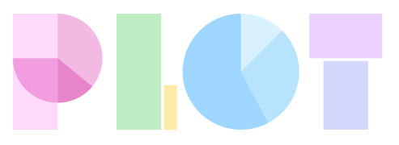

# Observable Plot

[**Observable Plot**](https://observablehq.github.io/plot/) is a free, [open-source](./LICENSE), JavaScript library for visualizing tabular data, focused on accelerating exploratory data analysis. It has a concise, memorable, yet expressive API, featuring [scales](https://observablehq.github.io/plot/features/scales) and [layered marks](https://observablehq.github.io/plot/features/marks) in the *grammar of graphics* style.

<a href="https://observablehq.observablehq.cloud/oss-analytics/@observablehq/plot">
  <picture>
    <source media="(prefers-color-scheme: dark)" srcset="https://observablehq.observablehq.cloud/oss-analytics/@observablehq/plot/downloads-dark.svg">
    
  </picture>
</a>

Daily downloads of Observable Plot · [oss-analytics](https://observablehq.observablehq.cloud/oss-analytics/)

## Documentation 📚

https://observablehq.github.io/plot/

## Examples 🖼️

https://observablehq.com/@observablehq/plot-gallery

## Releases 🚀

See our [CHANGELOG](https://github.com/observablehq/plot/blob/main/CHANGELOG.md) and summary [release notes](https://github.com/observablehq/plot/releases).

## Getting help 🏠

See our [community guide](https://observablehq.github.io/plot/community).

## Contributing 🙏

See [CONTRIBUTING.md](./CONTRIBUTING.md).
